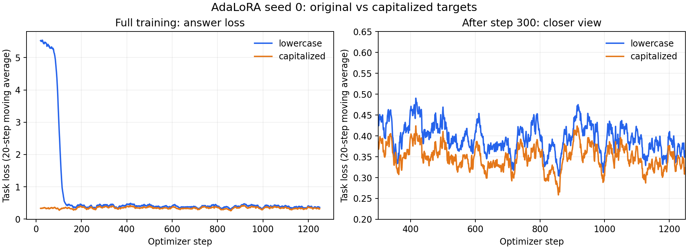

# Results

LLaVA-1.5-7B on two datasets: [GQA](#gqa) (already in LLaVA's training data) and [ScienceQA](#scienceqa) (new to LLaVA).

**Batch** is microbatch × gradient accumulation (16 questions per update either way). ⚠️ **4 × 4** runs used the shared
trainer (`peft_lora/train_lora.py`), which did not pass `modalities` to LLaVA-NeXT. In the installed version, a batch of 4
without it keeps only the first sample for the loss, so these runs may have learned from ~1 of every 4 training questions.
Treat them as provisional until rerun with the fix; comparisons with the **1 × 16** runs (AdaLoRA) are not fair yet.
Zero-shot and information-flow results do not train, so they are not affected.

## GQA

GQA testdev-balanced (12,578 questions).

Training answers are either lowercase (GQA's original answers) or capitalised (first letter uppercase, matching
LLaVA's own style). Capitalised training scores higher, so the two are kept in separate tables and only rows in the
same table should be compared. Using capitalised training for configurations moving forward.

### Baseline

| Configuration | Accuracy (%) | Batch (micro × accum) | Notes |
|---|---|---|---|
| Zero-shot (no fine-tuning) | 61.91 | – | 7,787 / 12,578 correct; paper reports 62.0 |

### Capitalised training answers

| Configuration | Accuracy (%) | Batch (micro × accum) | Notes |
|---|---|---|---|
| Uniform LoRA (rank 8), seed 0 | 61.94 | 4 × 4 ⚠️ | 7,791 / 12,578 correct; `uniform/default/seed0` (rerun on capitalised answers) |
| Uniform LoRA (rank 8), seed 1 | 61.99 | 4 × 4 ⚠️ | 7,797 / 12,578 correct; [outputs](output/peft/uniform/default/seed1/eval/metrics.json) |
| Uniform LoRA (rank 8), seed 2 | 61.93 | 4 × 4 ⚠️ | 7,789 / 12,578 correct; [outputs](output/peft/uniform/default/seed2/eval/metrics.json) |
| **Uniform LoRA (rank 8), mean of seeds 0–2** | **61.95 ± 0.03** | 4 × 4 ⚠️ | sample std over 3 seeds; +0.04 vs zero-shot (61.91) |
| AdaLoRA (init rank 12 → avg 8), seed 0 | 62.56 | 1 × 16 | 7,869 / 12,578 correct; [outputs](output/peft/adalora_capfirst/seed0/eval/metrics.json); +1.12 vs lowercase seed 0 |
| AdaLoRA (init rank 12 → avg 8), seed 1 | 62.45 | 1 × 16 | 7,855 / 12,578 correct; [outputs](output/peft/adalora_capfirst/seed1/eval/metrics.json) |
| AdaLoRA (init rank 12 → avg 8), seed 2 | 62.47 | 1 × 16 | 7,857 / 12,578 correct; [outputs](output/peft/adalora_capfirst/seed2/eval/metrics.json) |
| **AdaLoRA, mean ± sample std of seeds 0–2** | **62.49 ± 0.06** | 1 × 16 | Calculated from exact correct counts; std in percentage points, ddof=1; [summary](output/peft/adalora_capfirst/three_seed_summary.json) |
| Flow-guided LoRA, seed 0 | 61.77 | 4 × 4 ⚠️ | 7,770 / 12,578 correct; `flow_guided/default/seed0`; log shows target 'Right</s>' |
| Flow-guided LoRA, seed 1 | 62.03 | 4 × 4 ⚠️ | 7,802 / 12,578 correct; `flow_guided/default/seed1` |
| Flow-guided LoRA, seed 2 | 61.57 | 4 × 4 ⚠️ | 7,744 / 12,578 correct; `flow_guided/default/seed2` |
| **Flow-guided LoRA, mean of seeds 0–2** | **61.79 ± 0.23** | 4 × 4 ⚠️ | sample std over 3 seeds; −0.12 vs zero-shot (61.91), within seed-to-seed variation |
| Inverse-flow LoRA, seed 0 | 62.13 | 4 × 4 ⚠️ | 7,815 / 12,578 correct; [outputs](output/peft/inverse_flow/seed0/eval/metrics.json); capitalized targets; rank budget 512 |
| Inverse-flow LoRA, seed 1 | 62.16 | 4 × 4 ⚠️ | 7,819 / 12,578 correct; [outputs](output/peft/inverse_flow/default/seed1/eval/metrics.json); capitalized targets; rank budget 512 |
| Inverse-flow LoRA, seed 2 | 62.16 | 4 × 4 ⚠️ | 7,819 / 12,578 correct; [outputs](output/peft/inverse_flow/default/seed2/eval/metrics.json); capitalized targets; rank budget 512 |
| **Inverse-flow LoRA, 3-seed mean ± SD** | **62.15 ± 0.018** | 4 × 4 ⚠️ | Seeds 0, 1, 2; sample SD in percentage points |

### Variants

Capitalised training answers, with a change to the training data or setup.

| Configuration | Accuracy (%) | Batch (micro × accum) | Notes |
|---|---|---|---|
| Uniform LoRA (rank 8), trained on mistakes, seed 0 | 61.63 | 4 × 4 ⚠️ | 7,752 / 12,578 correct; `uniform/train_mistakes_llava/seed0`; 5,753 zero-shot-wrong + 5,753 right training questions |

### Lowercase training answers

| Configuration | Accuracy (%) | Batch (micro × accum) | Notes |
|---|---|---|---|
| Uniform LoRA (rank 8), seed 0 | 61.27 | 4 × 4 ⚠️ | 7,706 / 12,578 correct; `configs/ranks/uniform.json` |
| Uniform LoRA (rank 8), seed 0, rerun | 61.36 | 4 × 4 ⚠️ | 7,718 / 12,578 correct; `uniform/default/seed0`; meant to be capitalised, but the cluster still had the lowercase training file |
| AdaLoRA (init rank 12 → avg 8), seed 0 | 61.44 | 1 × 16 | 7,728 / 12,578 correct; [outputs](output/peft/adalora/seed0/eval/metrics.json); final ranks in `adalora_seed0_ranks.csv` |
| AdaLoRA (init rank 12 → avg 8), seed 1 | 61.35 | 1 × 16 | 7,717 / 12,578 correct; [outputs](output/peft/adalora/seed1/eval/metrics.json) |
| Flow-guided LoRA, seed 0 | 61.02 | 4 × 4 ⚠️ | 7,675 / 12,578 correct; ranks averaged over 6 question types (`configs/ranks/flow_guided.json`) |
| Flow-guided LoRA, seed 0, rerun | 61.24 | 4 × 4 ⚠️ | 7,703 / 12,578 correct; same setup as 61.02 (log shows 'right</s>'); shows run-to-run variation of ~0.2 |
| Flow-guided LoRA, seed 1 | 61.07 | 4 × 4 ⚠️ | 7,681 / 12,578 correct; `flow_guided/lowercase/seed1` |
| Flow-guided LoRA, LR 1e-4, seed 0 | 61.06 | 4 × 4 ⚠️ | 7,680 / 12,578 correct; LR 2e-4 → 1e-4 made no difference (61.02) |
| Flow-protected LoRA, seed 0 | 61.54 | 4 × 4 ⚠️ | 7,740 / 12,578 correct; `configs/ranks/flow_protected.json`; no LoRA on layers 9–15 (critical flow layers), rank 10–11 elsewhere; trained before the cluster's training file was capitalised |

## ScienceQA

ScienceQA-IMG test (2,017 multiple-choice questions with a picture); trained on the 6,218 training questions with a picture
(`datasets/scienceqa/train_llava.json`). Answers are option letters (A, B, C, ...). Same LoRA budget and settings as GQA.
Run folders: `output/peft/<ranks>/scienceqa_train_llava/seed<k>/eval_scienceqa/`.

### Baseline

| Configuration | Accuracy (%) | Batch (micro × accum) | Notes |
|---|---|---|---|
| Zero-shot (no fine-tuning) | 69.16 | – | 1,395 / 2,017 correct; LLaVA-1.5 paper reports 66.8 (prompt details differ); `zero_shot/eval_scienceqa`; by subject: natural 67.41, social 72.12, language 65.91 |

### LoRA methods

| Configuration | Accuracy (%) | Batch (micro × accum) | Notes |
|---|---|---|---|
| Uniform LoRA (rank 8), seed 0 | | 4 × 4 ⚠️ | being rerun |
| Uniform LoRA (rank 8), seed 1 | | | |
| Uniform LoRA (rank 8), seed 2 | | | |
| **Uniform LoRA, mean of seeds 0–2** | | | |
| AdaLoRA (init rank 12 → avg 8), seed 0 | | | |
| AdaLoRA (init rank 12 → avg 8), seed 1 | | | |
| AdaLoRA (init rank 12 → avg 8), seed 2 | | | |
| **AdaLoRA, mean of seeds 0–2** | | | |
| Flow-guided LoRA (GQA ranks), seed 0 | | | `configs/ranks/flow_guided.json` (from the GQA flow graphs) |
| Flow-guided LoRA (GQA ranks), seed 1 | | | |
| Flow-guided LoRA (GQA ranks), seed 2 | | | |
| **Flow-guided LoRA (GQA ranks), mean of seeds 0–2** | | | |
| Inverse-flow LoRA, seed 0 | | | `configs/ranks/inverse_flow.json` |
| Inverse-flow LoRA, seed 1 | | | |
| Inverse-flow LoRA, seed 2 | | | |
| **Inverse-flow LoRA, mean of seeds 0–2** | | | |
| Flow-guided LoRA (ScienceQA ranks), seed 0 | | | ranks from the ScienceQA flow graphs (to be made) |
| Flow-guided LoRA (ScienceQA ranks), seed 1 | | | |
| Flow-guided LoRA (ScienceQA ranks), seed 2 | | | |
| **Flow-guided LoRA (ScienceQA ranks), mean of seeds 0–2** | | | |

## AdaLoRA capitalization comparison

The seed 0 comparison changes only the first character of each training answer to uppercase; the remaining data, training settings and evaluation are unchanged. Evaluation lowercases predictions and references before exact matching, so the improvement is not direct credit for matching answer case. The detailed loss and short-step comparisons are for seed 0. Capitalised seeds 0–2 are now complete (62.49 ± 0.06%, sample std); the improvement versus lowercase is not a three-seed paired estimate because lowercase seed 2 was not run. Lowercase seed 1 scored 61.35% versus 62.45% capitalised.

- Full training: 205.4 minutes lowercase versus 201.0 minutes capitalised; this small timing difference does not establish a speed improvement.
- On the fixed exploratory 512-question subset, step 100 accuracy was 61.13% lowercase versus 60.94% capitalised (one question difference). The short comparison provides no clear early learning advantage.
- Over the final 250 training updates, answer/task loss averaged 0.383 lowercase versus 0.342 capitalised, with per-update standard deviations 0.142 versus 0.127. These exclude AdaLoRA regularization and compare different target casing/tokenization; loss alone is not a measure of task accuracy.

[Full paired comparison](output/peft/adalora_capfirst/seed0/capitalization_comparison.json) · [Short comparison](output/diagnostics/case_training/quick_comparison.json) · [Run provenance](output/peft/adalora/README.md)

## AdaLoRA reproducibility and report notes

- [Frozen training implementation and TC2 instructions](experiments/adalora_reproduction/README.md): the exact source used for these runs, added without replacing the shared trainer.
- [AdaLoRA report and presentation notes](docs/ADALORA_REPORT_NOTES.md): method, parameters, results, ranks, compute and limitations.
- Final per-layer q/v ranks and masks are stored with each capitalised run. AdaLoRA does not consume information-flow graphs.
