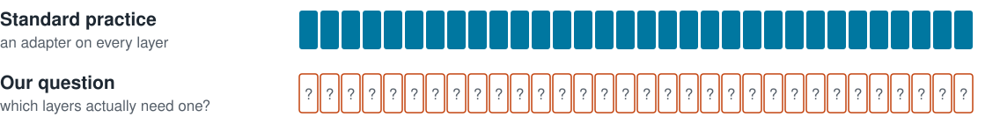
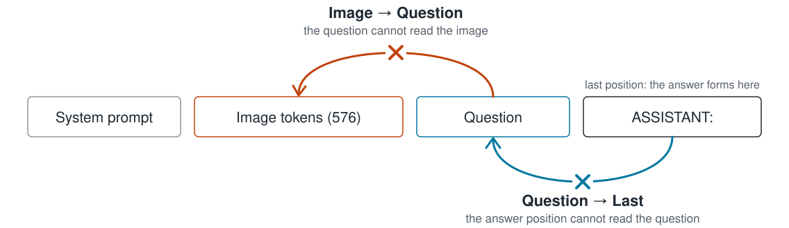
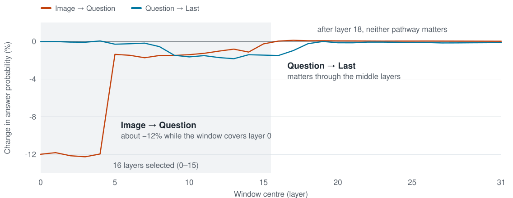
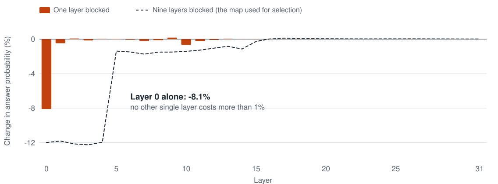
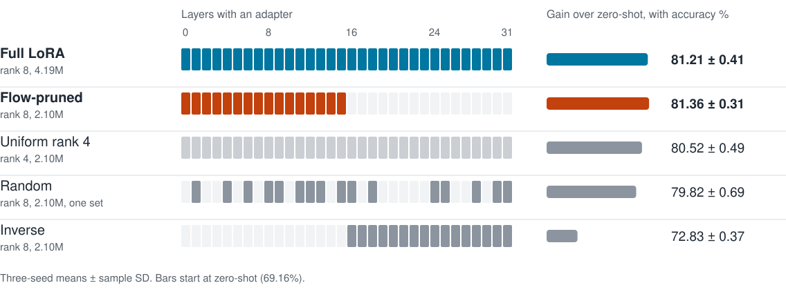
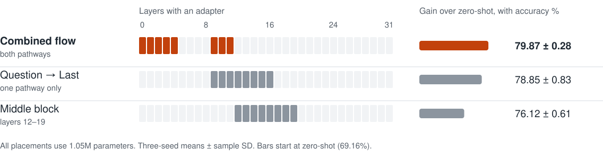
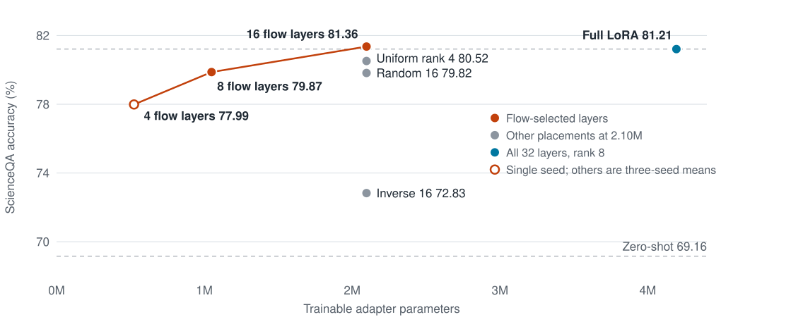
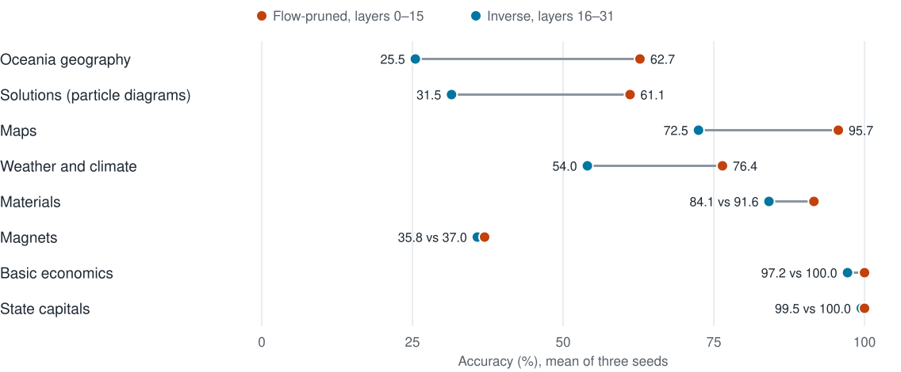
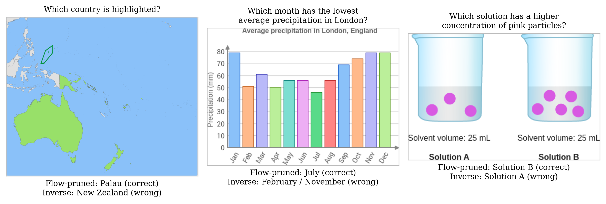
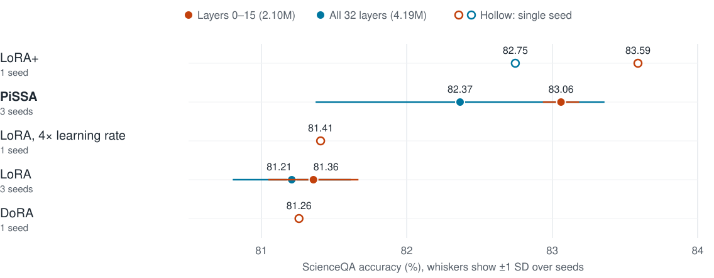

<!-- _class: cover -->
<!-- _paginate: false -->
<!-- _footer: '' -->

# Analyzing the Effect of Parameter-Efficient Finetuning using Visual Information Flow Signals for Multimodal Language Models

Where should LoRA go in LLaVA-1.5-7B?

**Priyanka Srinivas, Ananya Tirumala, Nop Polboon, Swarangi Satpute**

AI6130: Large Language Models, Nanyang Technological University

---

<!-- _class: outline -->

# Outline

1. Motivation and research question
2. Measuring information flow by attention knockout
3. Main result: half the adapter, same accuracy
4. Why these layers: placement, pathways and questions
5. Other adapters and GQA
6. Conclusions and limitations

---

# Motivation

- LoRA adapts a model by training a small low-rank update beside frozen weights
- Standard practice applies it uniformly to all 32 language-model layers
- Information-flow studies (Zhang et al., 2025; Yin et al., 2025) map where image information reaches the question
- That map has been used to explain models, but not to choose where to tune them

> **Research question:** can the information-flow map identify which layers should receive an adapter?

---

# Method: Attention Knockout

- Compare the probability of the correct answer with and without the connection
- Block a 9-layer window at each of the 32 positions; score each layer by the sum of both drops
- Measured once on 989 ScienceQA *training* questions, so no test data is used for selection

---

# The Flow Map Ranks Layers 0–15 Highest

The image enters the question in the first layers; the question carries it to the answer through the middle layers. After layer 18, neither pathway matters.

---

# Layer 0 Carries the Image into the Question

- Layer 0 holds **about 90%** of the early image-to-question flow
- The middle-layer flow is spread out, which is why the 9-layer window is used to rank layers
- 20% of questions lose more than 10%: mostly *maps and geography*

---

# Experimental Setup

| Component | Configuration |
|---|---|
| Model | LLaVA-1.5-7B; LoRA on query and value projections, rank 8 |
| ScienceQA (image subset) | 6,218 training and 2,017 test questions, new to the model |
| GQA | 20,000 training and 12,578 test questions, part of LLaVA's training data |
| Evaluation | Three seeds; paired McNemar tests on identical test questions |

## Implementation corrections made before the reported results

| Issue | Effect of the correction |
|---|---|
| Batches of four retained only the first sample | ScienceQA uniform LoRA, seed 0: 77.64 → **80.86** |
| GQA training answers were lowercase | GQA AdaLoRA, seed 0: 61.44 → **62.56** |

---

<!-- _class: stats -->

# Flow-Pruned LoRA Matches Full LoRA at Half the Parameters

| 81.36% | 2.10M | 8.4 MB |
|---|---|---|
| Flow-pruned accuracy, against 81.21% for full LoRA and 69.16% zero-shot | Trainable parameters on layers 0–15, down from 4.19M | Saved adapter size, down from 16.8 MB |

- Within 0.25 points on every seed; paired difference not significant (64 vs 55 questions, p = 0.46)
- Same training loss (0.193 vs 0.192): the 16 layers left out add nothing to the fit
- *The saving is in adapter size, not compute: 57 vs 61 minutes of training*

---

# Placement Matters at an Equal Parameter Budget

- **Rank 4 everywhere** loses 0.84 points: the adapter cannot simply be shrunk everywhere
- **Random half** misses layers 0, 2 and 3, where the image enters the question
- **Opposite half** gains only 3.7 points, and its training loss stays about 50% higher

Flow-pruned leads on every seed; all paired differences are significant (p < 0.001).

---

# The Image-to-Question Layers Cannot Be Left Out

- Eight layers, two ways of using the map: the combined score keeps layers 0–4 and 9–11
- **Question → Last only** drops layers 0–4: −1.0 point (256 vs 194 questions, p = 0.004)
- **Middle block 12–19** loses 3.8 points (405 vs 178, p = 2×10⁻²¹), most in the hardest grades

---

# Accuracy Declines Gradually as the Adapter Shrinks

Share of the full-LoRA gain retained: **101% with 16 layers**, 89% with 8 layers, 73% with 4 layers (single seed). Four flow layers beat 16 inverse layers by 5.6 points with a quarter of the parameters.

---

# Without the Flow Layers, Image Questions Fail

- Maps, particle diagrams and climate charts drop by **20–37 points** with inverse placement
- Questions answered mostly from the words (state capitals, economics) barely move
- 130 test questions are right with flow-pruned and wrong with inverse on **all three seeds**; only 18 go the other way

---

# Examples Inverse Placement Always Gets Wrong

Right with flow-pruned LoRA and wrong with inverse LoRA on all three seeds: a highlighted country, the driest month on a climate chart, and particle concentration. These are the same map and diagram questions that depend on layer 0 in the knockout.

---

# The Same Layers Work with Stronger Adapters

- **PiSSA on the flow layers: 83.06%**, 0.69 above PiSSA on all layers (213 vs 171, p = 0.04), with an eight times smaller spread across seeds
- PiSSA improves on plain LoRA in the same layers by 1.7 points (270 vs 167, p = 10⁻⁶)
- LoRA+ points the same way (seed 0); DoRA and a 4× learning rate match plain LoRA

---

# On GQA, the Model Already Knows the Task

| Same 4.19M parameters, rank moved between layers | Accuracy (%) |
|---|---:|
| Zero-shot | 61.91 |
| Uniform ranks | 62.73 ± 0.19 |
| More rank in flow layers | 62.62 ± 0.22 |
| More rank elsewhere | 62.75 ± 0.04 |
| AdaLoRA | 62.49 ± 0.06 |

- Every rank allocation gains under 1 point, against 12 on ScienceQA; none of the differences is significant
- The GQA map shows the same early image-to-question flow, so the map is not wrong here
- *GQA is part of LLaVA's training data, so there is little left for any adapter to learn*

---

# Further Experiments

| Experiment | Dataset, seeds | Accuracy (%) | Compared with |
|---|---|---:|---:|
| More rank in flow layers, all 32 kept | ScienceQA, 3 | 81.37 | 81.21 (p = 0.51) |
| Less rank in flow layers, all 32 kept | ScienceQA, 3 | 79.21 | 81.21 (worse every seed) |
| LoRA on text tokens only | ScienceQA, 1 | 81.06 | 81.11 |
| LoRA on image tokens only | ScienceQA, 1 | 80.71 | 81.11 |
| Learnable gates on the flow | ScienceQA, 1 | 81.16 | 80.86 (p = 0.33) |
| Loss rewarding use of the flow | GQA, 1 | 62.84 | 62.80 (p = 0.82) |
| AdaLoRA | ScienceQA, 3 | 71.36 | 81.21 |

Text-only and image-only LoRA both match all tokens: what LoRA tunes in these layers is the *mixing* of image and question.

---

<!-- _class: two -->

# Conclusions

## Findings

- **Knockout locates** where LLaVA mixes the image into the question: layer 0, then the middle layers
- **LoRA on those 16 layers matches full LoRA** with half the parameters
- Equal-budget alternatives are worse on every seed

## Limitations

- The saving is in adapter size, not training compute
- One model and one new task; several controls are single-seed
- The map is built from questions the model already answers

## Recipe and future work

- Run the knockout once on about 1,000 training questions, keep the top half of the layers, train any LoRA variant there
- Next: larger models, and new tasks such as charts, documents or medical images

---

<!-- _class: divider -->
<!-- _footer: '' -->
<!-- _paginate: false -->

# Thank You

Questions and discussion are welcome.
