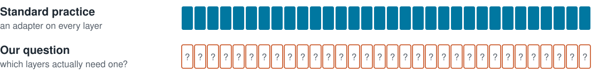
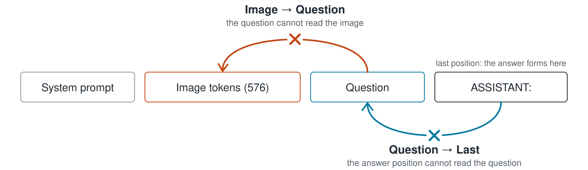
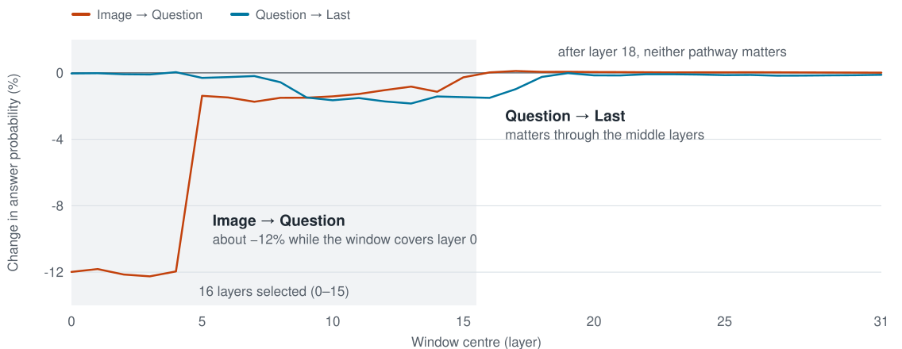
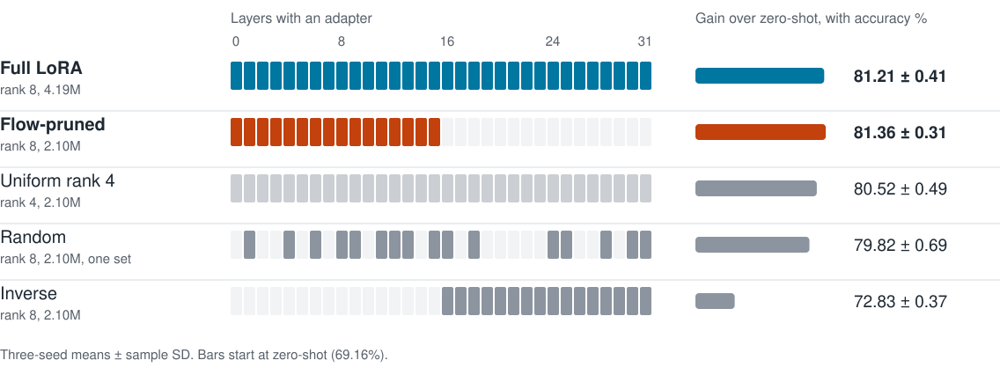
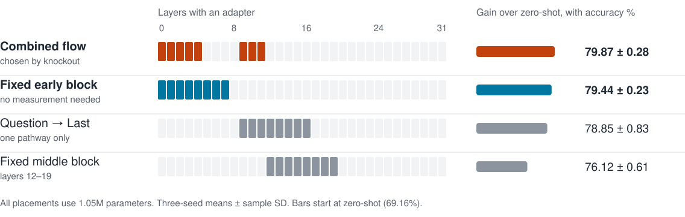
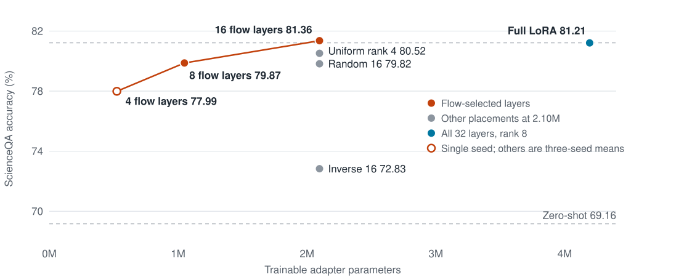
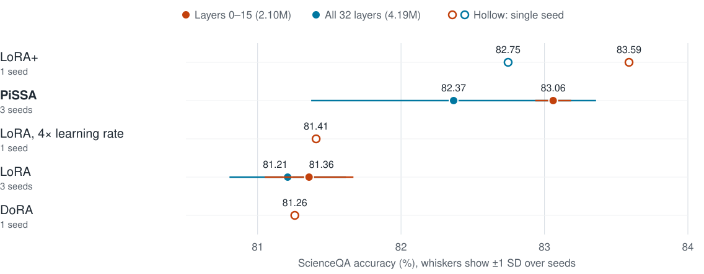
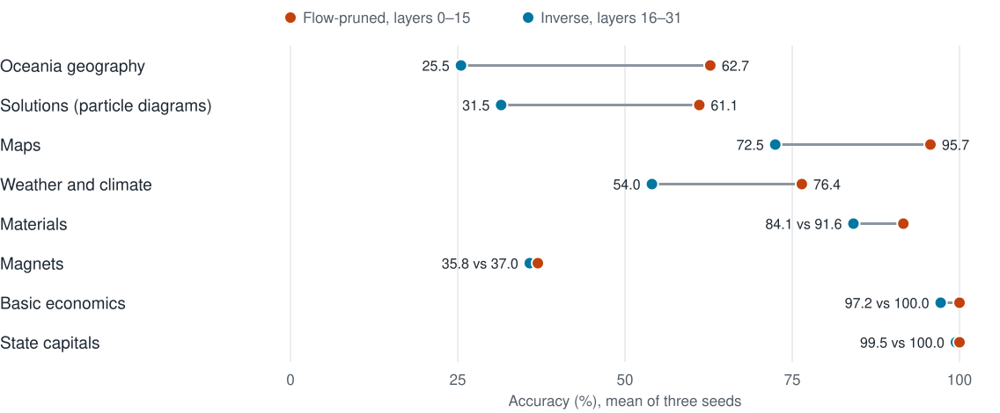

<!-- _class: cover -->
<!-- _paginate: false -->
<!-- _footer: '' -->

# Does Visual Information Flow Indicate Where to Fine-Tune a Multimodal Model?

An evaluation of LoRA placement in LLaVA-1.5-7B

**Nop Polboon, Priyanka Srinivas, Ananya Tirumala, Swarangi Satpute**

AI6130: Large Language Models, Nanyang Technological University

---

<!-- _class: outline -->

# Outline

1. Motivation and research question
2. Measuring information flow by attention knockout
3. Experimental setup and preliminary results
4. Results on layer placement and adapter choice
5. Flow selection compared with simple depth rules
6. Conclusions and future work

---

# Motivation

- LoRA adapts a model by training a small low-rank update beside frozen weights
- Standard practice applies it uniformly to all 32 language-model layers
- Zhang et al. (2025) mapped where image information reaches the question inside the model
- That map has been used to explain models, but not to choose where to tune them

> **Research question:** can the information-flow map identify which layers should receive an adapter?

---

# Method: Attention Knockout

- Compare the probability of the correct answer with and without the connection
- Block a 9-layer window at each of the 32 positions; score each layer by the sum of both drops
- Measured once on 989 ScienceQA *training* questions, so no test data is used for selection

---

# The Flow Map Ranks Layers 0–15 Highest

Blocking layers one at a time, **layer 0 alone accounts for −8.1%**. *Layers 1–4 rank highly mainly because their windows include layer 0.*

---

# Experimental Setup

| Component | Configuration |
|---|---|
| Model | LLaVA-1.5-7B; LoRA on query and value projections, rank 8 |
| ScienceQA (image subset) | 6,218 training and 2,017 test questions; new to the model |
| GQA | 20,000 training and 12,578 test questions; part of LLaVA's training data |
| Evaluation | Mostly three seeds; paired tests on identical test questions |

## Implementation corrections made before the reported results

| Issue | Effect of the correction |
|---|---|
| Batches of four retained only the first sample | ScienceQA uniform LoRA, seed 0: 77.64 → **80.86** |
| GQA training answers were lowercase | GQA AdaLoRA, seed 0: 61.44 → **62.56** |

---

# Preliminary Result: GQA Is Insensitive to Rank Allocation

| Allocation of the same 4.19M parameters | Accuracy (%) | Gain over zero-shot |
|---|---:|---:|
| Zero-shot baseline | 61.91 | – |
| Uniform | 62.73 ± 0.19 | +0.82 |
| More rank in flow layers | 62.62 ± 0.22 | +0.71 |
| More rank in other layers | 62.75 ± 0.04 | +0.84 |

- All three allocations are statistically tied, with little gain over the baseline
- LLaVA already saw GQA during training, which may limit what is left to learn
- *Only rank allocation was tested here; layers were not removed on GQA*

The main study therefore uses **ScienceQA**, which offers substantially more room for improvement.

---

<!-- _class: stats -->

# Flow-Pruned LoRA Matches Full LoRA at Half the Parameters

| 81.36% | 2.10M | 8.4 MB |
|---|---|---|
| Flow-pruned accuracy, against 81.21% for full LoRA and 69.16% zero-shot | Trainable parameters on layers 0–15, down from 4.19M | Saved adapter size, down from 16.8 MB |

- Paired comparison: 64 vs 55 questions, p = 0.46, so no detectable difference
- The two methods are within 0.25 points on every seed
- *Training time barely changes (57 vs 61 minutes), because gradients still pass through all layers*

---

# Placement Matters at an Equal Parameter Budget

Flow-pruned LoRA leads each 2.10M alternative on every seed, and **the pooled paired differences are all significant** (p < 0.001).

---

<!-- _class: divider -->
<!-- _footer: '' -->
<!-- _paginate: false -->

# However, Layers 0–15 Are Exactly the First Half of the Model

Is the effect due to information flow, or simply to depth?

---

# A Simple Early-Layer Rule Performs Comparably

- Combined flow vs fixed early block: 176 vs 150 questions, p = 0.17, **not significant**
- A gradient-size rule selects the same 16 layers as flow, without any knockout
- *Accuracy falls largely with depth, so flow has not been shown to outperform a depth rule*

---

# Accuracy Declines Gradually as the Adapter Shrinks

Share of the full-LoRA gain retained: **101% with 16 layers**, 89% with 8 layers, 73% with 4 layers (single seed).

---

# Adapter Choice Adds More Than Further Placement Changes

- **PiSSA improves on plain LoRA by 1.70 points** on layers 0–15 (270 vs 167 questions)
- *The lead over all-layer PiSSA (0.69 points) is suggestive only: the order reverses on seed 1*

---

# Inverse Placement Loses Most on Image-Heavy Categories

*The link to the flow map is partial:* state capitals form the largest layer-0-dependent group (74 of 194 questions), yet accuracy barely changes.

---

# Additional Experiments Showed No Accuracy Gain

| Experiment | Dataset, seeds | Accuracy (%) | Compared with |
|---|---|---:|---:|
| More rank in flow layers | ScienceQA, 3 | 81.37 | 81.21 (p = 0.51) |
| Learnable gates on the flow | ScienceQA, 1 | 81.16 | 80.86 (p = 0.33) |
| Loss rewarding use of the flow | GQA, 1 | 62.84 | 62.80 (p = 0.82) |
| The same loss with random crops | GQA, 1 | 62.04 | 62.80 (worse) |
| LoRA on text tokens only | ScienceQA, 1 | 81.06 | 81.11 |
| LoRA on image tokens only | ScienceQA, 1 | 80.71 | 81.11 |
| AdaLoRA | ScienceQA, 3 | 71.36 | 81.21 |
| AdaLoRA without regularisation | ScienceQA, 3 | 76.42 | 81.21 |

AdaLoRA's remaining gap of about 5 points is *not yet explained*.

---

<!-- _class: two -->

# Conclusions

## Supported by the evidence

- **Half the adapter can match full LoRA** on ScienceQA
- **Early layers matter far more than late layers** (+8.53 points at equal budget)
- PiSSA adds about 1.7 points on the same layers

## Not established

- *That flow selects layers better than a simple depth rule*
- That layer 0 alone is sufficient, as it was never trained in isolation
- That results extend to other models, other tasks, or pruning on GQA

## Future work

- Train layer 0 alone, and compare layers 5–8 with layers 9–12 to separate flow from depth
- Evaluate pruned placements on GQA, whose flow map has strong middle-layer activity

---

<!-- _class: divider -->
<!-- _footer: '' -->
<!-- _paginate: false -->

# Thank You

Questions and discussion are welcome.
